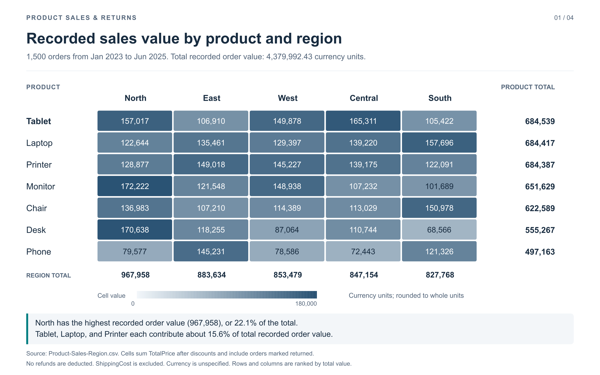
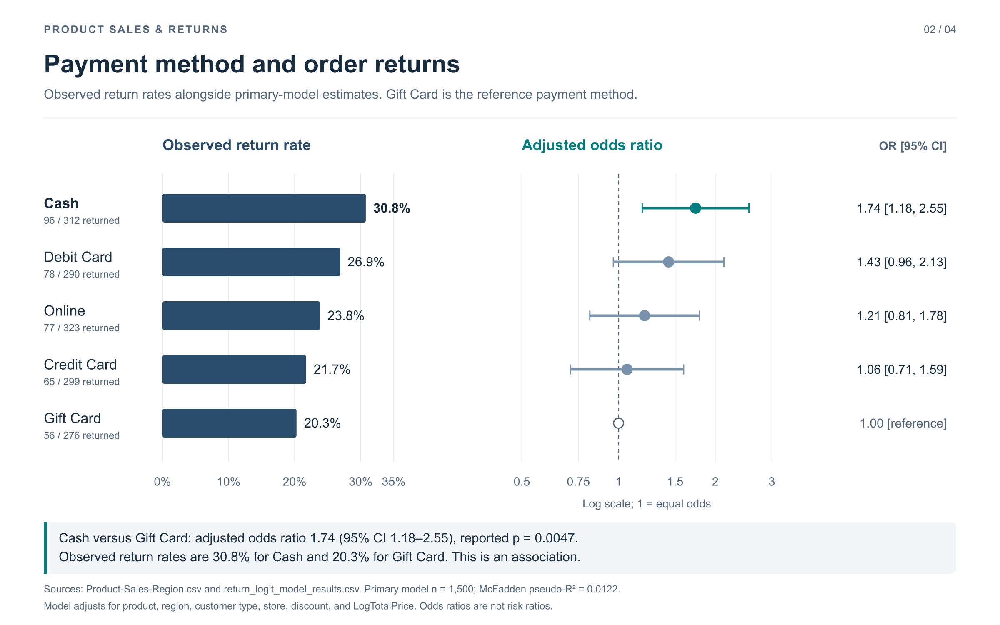
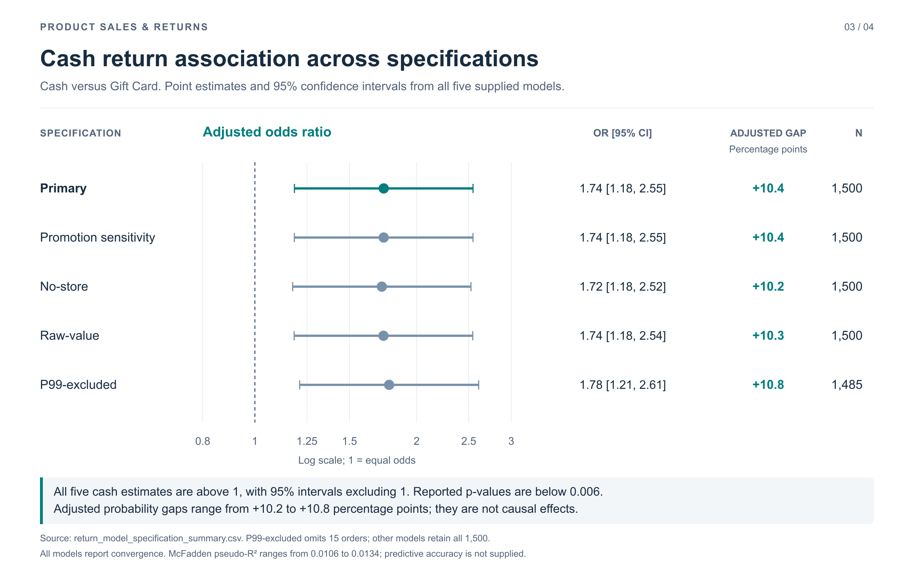
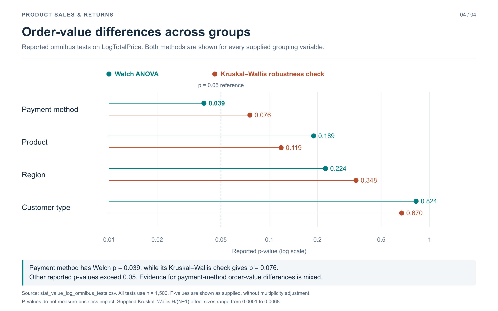

Superstore Sales & Profitability Analysis

**Analyzing 1,500 superstore transactions to identify sales patterns, investigate recorded returns, and recommend operational priorities.**

Cash transactions had the highest observed return rate among the five payment methods: **30.8%**, versus **20.3%** for Gift Card transactions. This project uses exploratory analysis, statistical comparisons, and logistic regression to translate that finding into practical investigation priorities.

**[View the Jupyter Notebook analysis](https://github.com/condorlamar-ctrl/superstore-sales-profitability-analysis/blob/main/sales_return_analysis%20%281%29.ipynb)** | **[Explore the dataset](https://github.com/condorlamar-ctrl/superstore-sales-profitability-analysis/blob/main/Product-Sales-Region.csv)** | **[View the regression results](https://github.com/condorlamar-ctrl/superstore-sales-profitability-analysis/blob/main/return_logit_model_results.csv)** | **[Compare model specifications](https://github.com/condorlamar-ctrl/superstore-sales-profitability-analysis/blob/main/return_model_specification_summary.csv)** | **[View the visualizations](#visualizations)**

> **Data limitation — currency:** The source dataset does not specify a currency. No currency denomination has been assumed. Monetary comparisons describe recorded transaction values; cost, margin, and refund data are insufficient to quantify profitability impacts.

## Business Problem

Product returns can create additional handling costs and affect sales performance. For a superstore, the key business question is:

> Which transaction characteristics are associated with recorded returns, and where should the business focus further investigation?

The analysis compares Cash and Gift Card transactions after accounting for available transaction characteristics. It also examines sales patterns across **7 products, 5 regions, 5 payment methods, and 2 customer types**. Each row represents one transaction.

## Results at a Glance

| Metric | Result |
| --- | ---: |
| Transactions analyzed | 1,500 |
| Transaction date coverage | January 2023–June 2025 |
| Products represented | 7 |
| Regions represented | 5 |
| Transactions marked returned | 372 |
| Overall observed return rate | 24.8% |
| Total recorded transaction value | 4,379,992.43 |
| Highest-value region | North — 967,957.98 |
| Primary adjusted Cash versus Gift Card odds ratio | 1.74 |
| Primary 95% confidence interval | 1.18–2.55 |

Recorded transaction value is **sum(TotalPrice)** after recorded discounts. It includes transactions marked returned, excludes ShippingCost, and has no deducted refund amounts. It should not be interpreted as net retained revenue or profit.

### Recorded Returns by Payment Method

| Payment method | Transactions | Marked returned | Observed return rate |
| --- | ---: | ---: | ---: |
| Cash | 312 | 96 | 30.8% |
| Debit Card | 290 | 78 | 26.9% |
| Online | 323 | 77 | 23.8% |
| Credit Card | 299 | 65 | 21.7% |
| Gift Card | 276 | 56 | 20.3% |

These groups cover all 1,500 transactions. Return rates measure the share of transactions marked **Returned = 1**, rather than the share of units returned or transaction value refunded.

**Business takeaway:** Cash transactions had a recorded return rate **10.5 percentage points** higher than Gift Card transactions. After adjustment, Cash transactions had **1.74 times the return odds** (**95% CI 1.18–2.55**, p = **0.0047**). The positive association persisted across all five supplied model specifications, making Cash return processes a priority for investigation. These associations do not establish that payment method causes returns.

## Visualizations

### 1. Recorded Sales Value by Product and Region

[View the full-size sales visualization](sales_value_product_region.png)

**Interpretation:** North accounts for **22.1%** of recorded transaction value. Tablet, Laptop, and Printer each contribute approximately **15.6%**. The heatmap includes every product-region combination, with rows and columns ranked by total value.

### 2. Payment Method and Order Returns

[View the full-size payment and returns visualization](payment_method_returns.png)

**Interpretation:** Cash has the highest observed return rate (**30.8%**), compared with **20.3%** for Gift Card. The primary model reports an adjusted Cash odds ratio of **1.74** relative to Gift Card. Confidence intervals show uncertainty around each payment-method estimate.

### 3. Cash Return Association Across Model Specifications

[View the full-size model comparison](cash_return_model_sensitivity.png)

**Interpretation:** Cash odds ratios range from **1.72 to 1.78**. All five 95% confidence intervals exclude 1. Reported adjusted probability differences range from **+10.2 to +10.8 percentage points**. Consistency across these specifications supports further investigation, without establishing causality.

### 4. Order-Value Differences Across Groups

[View the full-size statistical test comparison](order_value_omnibus_tests.png)

**Interpretation:** Payment method has a reported Welch p-value of **0.039**, while its Kruskal–Wallis robustness check gives **0.076**. Other reported p-values exceed 0.05. Evidence for payment-method differences in log transaction value is therefore mixed. These tests address transaction value, separately from the return model.

All four PNGs are **2,400 × 1,500 pixels**. Keep them beside this README in the repository so the image previews and direct links resolve.

## Approach & Tools

**Analysis tools:** Python, Pandas, and NumPy.

1. **Prepare the data:** Check transaction records, retain missing promotion information, and review derived features and outlier indicators.
2. **Explore sales and returns:** Compare transaction values, sales totals, and recorded return rates across transaction groups.
3. **Assess group differences:** Compare supplied Welch ANOVA and Kruskal–Wallis results for LogTotalPrice.
4. **Adjust the return comparison:** Review logistic regression estimates accounting for payment method, product, region, customer type, store location, discount, and LogTotalPrice.
5. **Check robustness:** Compare all five supplied specifications, including promotion, store, transaction-value, and outlier sensitivity analyses.

The visualizations calculate descriptive measures from the raw dataset and display the supplied inferential estimates. The original code and complete estimation procedures for those statistical outputs were not supplied; the models and tests were not independently refitted for these charts.

## Model Robustness

| Specification | Transactions | Cash odds ratio | 95% CI | Reported p-value | Adjusted probability gap |
| --- | ---: | ---: | --- | ---: | ---: |
| Primary | 1,500 | 1.74 | 1.18–2.55 | 0.0047 | +10.4 pp |
| Promotion sensitivity | 1,500 | 1.74 | 1.18–2.55 | 0.0047 | +10.4 pp |
| No-store | 1,500 | 1.72 | 1.18–2.52 | 0.0053 | +10.2 pp |
| Raw-value | 1,500 | 1.74 | 1.18–2.54 | 0.0048 | +10.3 pp |
| P99-excluded | 1,485 | 1.78 | 1.21–2.61 | 0.0033 | +10.8 pp |

The reference is **Gift Card**. **pp = percentage points.** Adjusted probability gaps are Cash minus Gift Card as reported in the specification summary. The P99-excluded model omits **15 transactions**.

All five models report convergence. McFadden pseudo-R² ranges from **0.0106 to 0.0134**, with **0.0122** for the primary model. Pseudo-R² is not the percentage of return variation explained, and an odds ratio is not a probability ratio. Calibration and holdout-validation results are not included in the supplied exports, so operational return prediction has not been established.

### Order-Value Test Summary

| Grouping variable | Welch ANOVA p-value | Kruskal–Wallis p-value |
| --- | ---: | ---: |
| Payment method | 0.039 | 0.076 |
| Customer type | 0.824 | 0.670 |
| Region | 0.224 | 0.348 |
| Product | 0.189 | 0.119 |

P-values are reported without multiplicity adjustment. They do not measure business impact. A p-value above 0.05 does not establish that groups are equivalent, and omnibus tests do not identify specific differing pairs.

## Data Validation

| Validation check | Result | What it establishes |
| --- | ---: | --- |
| Unique transaction identifiers | 1,500 of 1,500 | No duplicate OrderIDs |
| Missing fields used in descriptive charts | 0 | Sales, product, region, payment, and return measures are populated |
| Missing promotion information | 370 transactions (24.7%) | Missing promotion data remain distinct from verified absence of a promotion |
| Recorded value calculation | 1,500 of 1,500 pass | TotalPrice equals Quantity × UnitPrice × (1 − Discount) |
| Recorded return coding | 0 or 1 for all transactions | Observed return rates can be calculated from the supplied indicator |
| Primary model sample | 1,500 | Reported primary-model sample size agrees with the raw transaction count |
| Odds ratio and interval checks | All supplied terms agree | Odds ratios and interval bounds equal exponentiated coefficients and coefficient bounds |
| Primary Cash estimate | Matches specification summary | Cash odds ratio, interval, and p-value agree across the two model exports |
| Omnibus sample and group counts | All eight tests agree | Supplied counts match the raw dataset's comparison groups |

Promotion information is missing for **370 transactions**. The provided project description states that these records were retained as **MissingPromotion** in the prepared dataset. The source CSV remains unchanged, and all 1,500 transactions contribute to the descriptive charts.

## Recommended Operational Investigations

| Business priority | Proposed action | Outcome to measure |
| --- | --- | --- |
| Investigate Cash return processes | Review transaction records, return reasons, and handling procedures against comparable Gift Card transactions | Verified return reasons, return rates, and process differences |
| Examine sales concentration | Review North's recorded value and the product mix behind regional totals | Transaction volume, average order value, and independently verified retained sales |
| Improve promotion records | Distinguish no promotion from missing or unrecorded promotion information | Promotion-field completeness and consistency |
| Establish predictive usefulness | Obtain estimation procedures and assess calibration and holdout performance before operational prediction | Calibration, discrimination, and performance on unseen transactions |
| Quantify financial impact | Collect product costs, refund amounts, margins, and return-handling costs | Verified contribution margins and return-related costs |

These are proposed investigations. The project does not report implemented policy changes, reduced returns, or realized profit improvements.

## Limitations & Next Steps

- **Association versus causation:** Adjusting for observed characteristics does not establish why Cash transactions had more recorded returns.
- **Model performance:** Low pseudo-R² and the absence of supplied calibration and holdout-validation results restrict predictive use.
- **Subgroup evidence:** The supplied outputs do not establish reliable payment-method differences for specific product-region combinations.
- **Missing promotion information:** Missing values do not establish whether a promotion was absent or unrecorded.
- **Profitability data:** Currency, product costs, margins, refunds, and return-handling costs are insufficient to quantify profit or loss.
- **Statistical procedures:** Full sensitivity formulas and the probability-standardization procedure are not included in the CSV exports. Inferential estimates are used as supplied.
- **Scope:** Findings describe the supplied transactions. They do not establish outcomes beyond this dataset.

## Project Files

| File | Contents |
| --- | --- |
| [Analysis notebook](https://github.com/condorlamar-ctrl/superstore-sales-profitability-analysis/blob/main/sales_return_analysis%20%281%29.ipynb) | Sales and return analysis notebook |
| [Main transaction dataset](https://github.com/condorlamar-ctrl/superstore-sales-profitability-analysis/blob/main/Product-Sales-Region.csv) | 1,500 transactions with product, region, sales, payment, promotion, and return fields |
| [Primary regression results](https://github.com/condorlamar-ctrl/superstore-sales-profitability-analysis/blob/main/return_logit_model_results.csv) | Coefficients, adjusted odds ratios, confidence intervals, p-values, and fit metadata |
| [Model specification summary](https://github.com/condorlamar-ctrl/superstore-sales-profitability-analysis/blob/main/return_model_specification_summary.csv) | Cash estimates, adjusted probability differences, exclusions, and fit summaries across five specifications |
| [Order-value omnibus tests](stat_value_log_omnibus_tests.csv) | Welch ANOVA and Kruskal–Wallis comparisons across four grouping variables |
| [Sales by product and region](sales_value_product_region.png) | PNG heatmap of recorded transaction value, including product and region totals |
| [Payment method and returns](payment_method_returns.png) | PNG comparing observed return rates and adjusted return odds |
| [Model specification comparison](cash_return_model_sensitivity.png) | PNG showing all five Cash estimates and reported probability gaps |
| [Order-value test comparison](order_value_omnibus_tests.png) | PNG comparing all eight supplied omnibus p-values |
